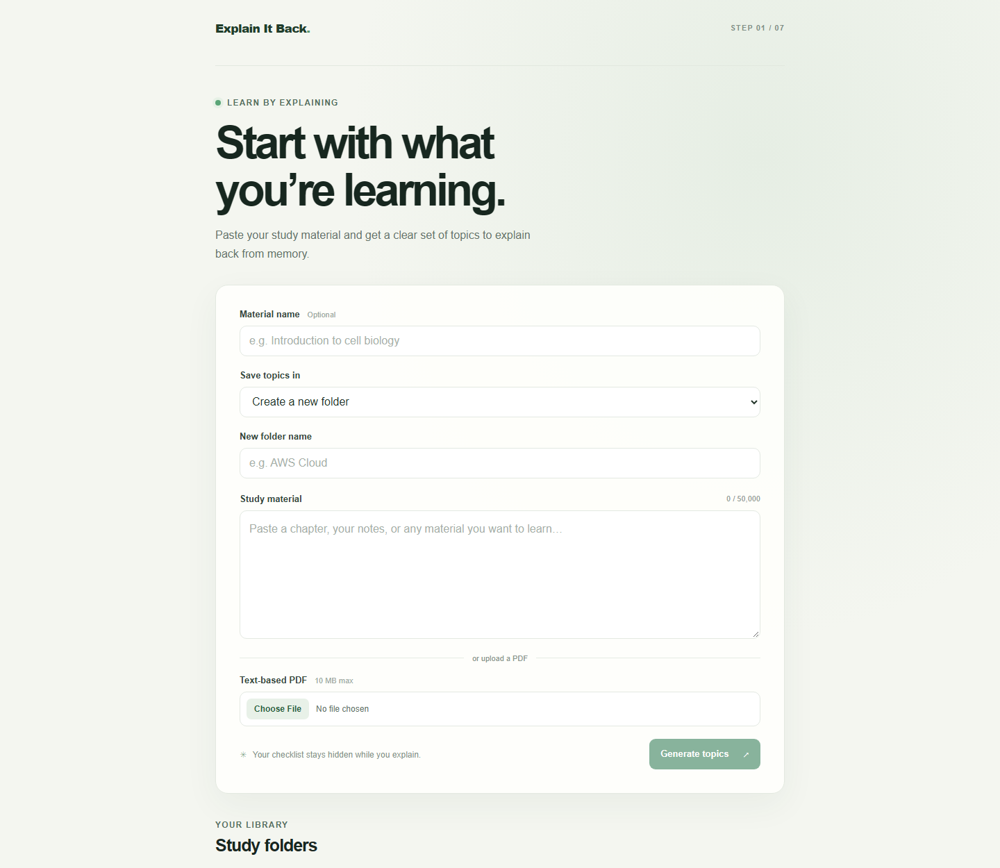

# Explain It Back

**Learn by explaining what you remember.** Explain It Back turns your study notes into topic checklists, lets you explain each topic from memory without peeking, grades your explanation, and generates targeted keywords and flashcards for the gaps.



**Project page:** [Explore the interactive project preview](https://hemonishrao.github.io/Explain-it-back/). The GitHub Pages site is a static showcase; the full AI-powered app runs locally (or on your own server) with your own Gemini API key.

---

## Features

- **Flexible inputs:** Paste study notes or upload a text-based `.pdf` or `.txt` file (up to 10 MB / 50,000 characters).
- **Study folders & topic overview:** Automatically extracts topics and key-point checklists, organizes them into folders, and tracks your latest score per topic on the home library and `/topics` page.
- **Recall-first explanation:** Explain a topic in your own words by typing or using browser voice input (where supported). Checklists stay hidden until you submit, with an optional **Get a hint** cue if you get stuck.
- **Fair, code-computed scoring:** The LLM evaluates each key point (`covered`, `partial`, `missed`) with exact quotes from your answer and flags factually incorrect statements; the backend computes the weighted score in code.
- **Targeted review:** Generates keywords and flip flashcards with **Got it / Review again** self-checks for missed or partial points.
- **Progress tracking:** View a score trend chart and full attempt history for every topic.

---

## Quick Start (Local Setup)

### What you need

- **[Node.js](https://nodejs.org/) 20 or newer** (includes `npm`) — check with `node -v`
- **A free [Google Gemini API key](https://aistudio.google.com/apikey)** (the app does not include a shared key)

### Step 1: Clone and install

```sh
git clone https://github.com/HemonishRao/Explain-it-back.git
cd Explain-it-back
npm install
```

### Step 2: Add your Gemini API key

Copy the example environment file to `server/.env`:

**Windows (PowerShell):**
```powershell
Copy-Item server/.env.example server/.env
```

**macOS / Linux:**
```sh
cp server/.env.example server/.env
```

Open `server/.env` and paste your key from [Google AI Studio](https://aistudio.google.com/apikey):

```env
GEMINI_API_KEY=your_api_key_here
PORT=5000
```

> **Keep your key private:** Never put `GEMINI_API_KEY` in `client/`, in a `VITE_*` variable, or in git commits. `server/.env` is already ignored by `.gitignore`.

### Step 3: Start the app

```sh
npm run dev
```

This starts both the frontend and backend together:
- **App (Frontend):** `http://localhost:5173` (open this in your browser)
- **API (Backend):** `http://localhost:5000` (health check at `http://localhost:5000/api/health`)

---

## Try It Out (Demo Walkthrough)

1. Open `http://localhost:5173`.
2. Enter a folder name (for example, `Operating Systems`) and paste this into **Study material**:
   > In operating systems, the CPU scheduler selects a process from the ready queue to run next. The dispatcher gives control of the CPU to the selected process. A context switch saves the state of the current process and restores the state of another process.
3. Click **Generate topics**, open a generated topic, and explain it from memory:
   > The CPU scheduler chooses which ready process runs next. The dispatcher hands the CPU to that process. During a context switch, the operating system saves the current process state and restores another process's state.
4. Submit to see your weighted score, checklist breakdown, and study flashcards.

---

## Available Scripts

| Command | What it does |
| --- | --- |
| `npm run dev` | Starts both the Express API (`:5000`) and Vite dev server (`:5173`) with auto-reload |
| `npm run dev:server` | Starts only the backend server with `node --watch` |
| `npm run dev:client` | Starts only the Vite React frontend |
| `npm test` | Runs the unit and route test suite (`node --test`) |
| `npm run build` | Builds the production frontend into `dist/` |
| `npm start` | Runs the Express server (serves both `/api` and the built `dist/` frontend) |

---

## Project Structure

```text
Explain-it-back/
├── client/                  # React + Vite frontend
│   └── src/
│       ├── api/             # Fetch wrapper for backend API calls
│       ├── components/      # Shared UI (PageShell, ConfirmDialog)
│       ├── pages/           # Upload, Topics, Explain, Results, Study, Progress, NotFound
│       └── styles.css       # App styles
├── server/                  # Express + SQLite backend
│   ├── routes/              # API endpoints (folders, materials, topics, attempts)
│   ├── services/            # Gemini client, extraction, chunking, grading, scoring, hints, PDF
│   ├── app.js               # Express app factory (used by index.js and tests)
│   ├── db.js                # SQLite schema & queries (better-sqlite3)
│   ├── prompts.js           # All LLM prompts & temperature settings
│   └── schemas.js           # Zod request/response validation schemas
├── tests/                   # Node built-in test suite (unit + HTTP route tests)
└── index.html, site.css, site.js  # Static GitHub Pages showcase (not the React app)
```

---

## Troubleshooting

- **"The AI service is not configured"**: Make sure `server/.env` exists, `GEMINI_API_KEY` is set without quotes/spaces, and restart `npm run dev`.
- **Port `5000` or `5173` already in use**: Close the other process using that port, or set a different `PORT` in `server/.env`.
- **"This PDF has no readable text"**: The PDF is likely scanned images. Use a text-based PDF, upload a `.txt` file, or paste the notes directly.
- **429 / Quota exceeded error**: You hit Gemini's free-tier per-minute or daily limit. Wait a minute or check your quota in Google AI Studio.
- **Voice input button not shown**: Browser speech recognition (Web Speech API) is best supported in Chrome and Edge and requires microphone permission.

---

## Production Deployment

The simplest setup is a single Node.js service serving both the built frontend and API from the same origin:

```sh
npm ci
npm run build
npm start
```

Configure these environment variables on your host (host environment variables override `server/.env`):

| Variable | Required | Purpose |
| --- | --- | --- |
| `GEMINI_API_KEY` | Yes | Server-only Gemini API key. Never expose it to the browser. |
| `GEMINI_MODEL` | No | Gemini model name; defaults to `gemini-flash-latest`. |
| `PORT` | No | HTTP port supplied by the host; defaults to `5000`. |
| `DATABASE_PATH` | Required on ephemeral hosts | Path to the SQLite file on persistent storage (defaults to `server/explain-it-back.sqlite`). Parent directory must exist and be writable. |
| `CORS_ORIGIN` | Separate frontend only | Comma-separated exact frontend origins (e.g., `https://app.example.com`). Leave empty for same-origin hosting. |
| `VITE_API_URL` | Separate frontend only | Public API origin baked into the frontend at build time (e.g., `https://api.example.com`, without `/api` or trailing slash). |

If hosting the frontend separately, set `VITE_API_URL` in `client/.env.local` (for local dev) or your frontend build environment, and add that frontend's exact origin to `CORS_ORIGIN` on the server.

### SQLite and persistent storage

Data is stored locally in SQLite using WAL mode (creating `-wal` and `-shm` files alongside the database). On hosts with ephemeral filesystems, mount a persistent disk and set `DATABASE_PATH` to a file on that disk. Run a single instance; this SQLite setup is not intended for multiple replicas sharing a network filesystem.

---

## Limitations and Privacy

- **Shared library (no auth):** There are no user accounts or per-user isolation. Anyone who can access a deployed instance can view and delete its folders and history—do not upload private notes to a public instance.
- **Third-party AI processing:** Study material, explanations, and remediation/hint requests are sent to Gemini through your server using your configured API key.
- **Input limits:** Max 50,000 characters per material, 5,000 characters per explanation, and 10 MB per uploaded `.pdf` or `.txt` file.
- **Best for theory subjects:** Works best for conceptual/theory-heavy topics (OS, biology, history, cloud concepts); math proofs and code-heavy topics are harder to grade by freeform explanation.

---

## Built With

React, Vite, React Router, Recharts, Node.js, Express, SQLite (`better-sqlite3`), Zod, `pdf-parse`, `multer`, and the Gemini API (`@google/genai`).

## License

No license has been added to this repository yet.
