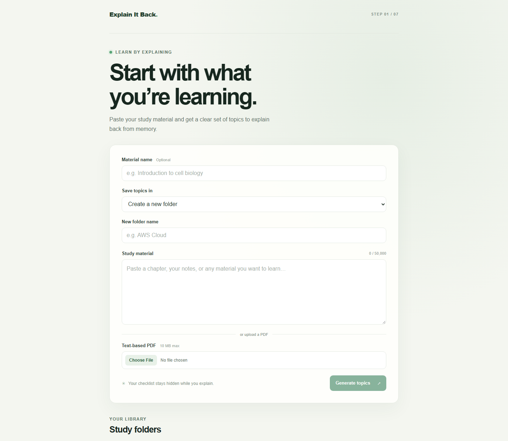

# Explain It Back

**Learn by explaining what you remember.** Explain It Back turns your notes into topics, then helps you check your understanding with a private, from-memory explanation.



## How it works

1. Paste your notes or upload a text-based PDF.
2. Get a set of topics organized into a study folder.
3. Pick a topic and explain it in your own words, without seeing its checklist.
4. Review your weighted score, what you covered or missed, and any incorrect statements.
5. Study missed ideas with generated keywords and flashcards, then try again.
6. Track your scores over time. You can also dictate an explanation in supported browsers.

The app extracts each topic checklist once and keeps it hidden until you submit an explanation. Scores are calculated by the backend from checklist importance and coverage.

## Try it locally

### You’ll need

- Node.js 20 or newer
- npm
- A Gemini API key from [Google AI Studio](https://aistudio.google.com/apikey)

### Start the app

Clone the repository and open a terminal in the project folder. Then install dependencies and create the server environment file:

```sh
npm install
```

On Windows PowerShell:

```powershell
Copy-Item server/.env.example server/.env
```

On macOS or Linux:

```sh
cp server/.env.example server/.env
```

Add your Gemini key to `GEMINI_API_KEY` in `server/.env`. Keep that file private; never paste your key into the browser or commit it to GitHub.

Start the backend and frontend together:

```sh
npm run dev
```

Open the Vite address printed in the terminal (usually `http://localhost:5173`). The backend runs on port `5000` by default.

## Quick demo

Paste this into **Study material**:

> In operating systems, the CPU scheduler selects a process from the ready queue to run next. The dispatcher gives control of the CPU to the selected process. A context switch saves the state of the current process and restores the state of another process.

Create a folder, select **Generate topics**, then open a topic and explain it from memory. For example:

> The CPU scheduler chooses which ready process runs next. The dispatcher hands the CPU to that process. During a context switch, the operating system saves the current process state and restores another process's state.

## Built with

React, Vite, React Router, Recharts, Node.js, Express, SQLite, Zod, and the Gemini API.

## Notes

- Pasted material is limited to 50,000 characters; explanations to 5,000 characters.
- PDF uploads must be text-based and no larger than 10 MB. Scanned image PDFs are not supported.
- The app sends study material to Gemini to create topics and explanations to Gemini for grading and study aids. Use a key you control and avoid submitting sensitive information.
- The app is designed for theory-heavy subjects. Math-heavy and code-heavy material may be harder to assess.

## License

No license has been added to this repository yet.
